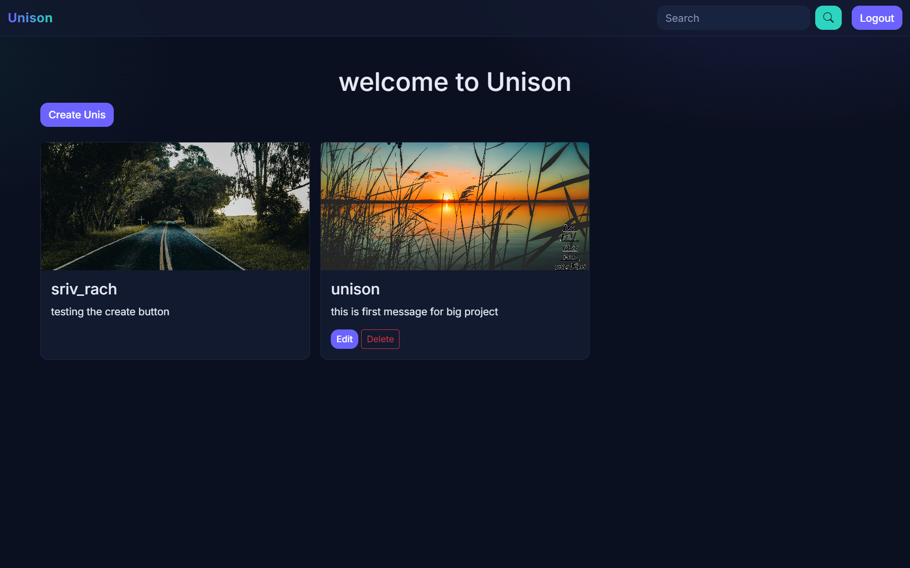
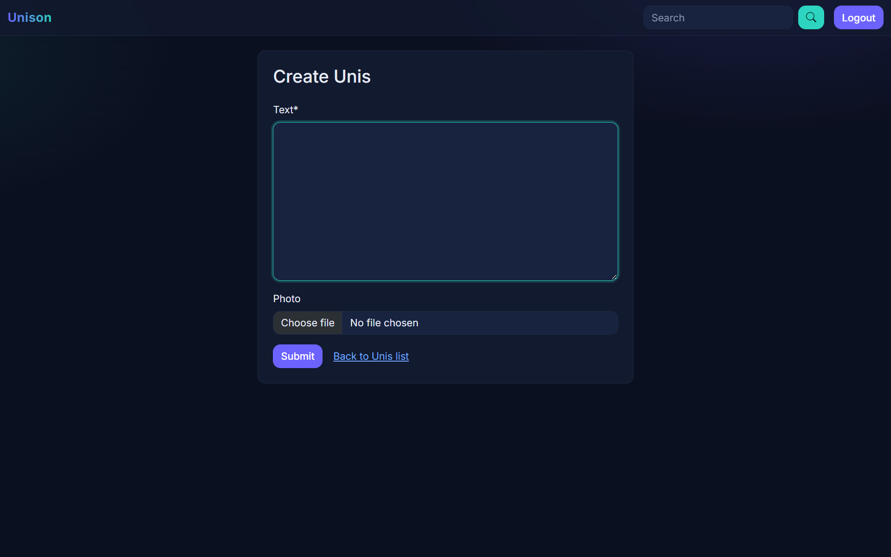
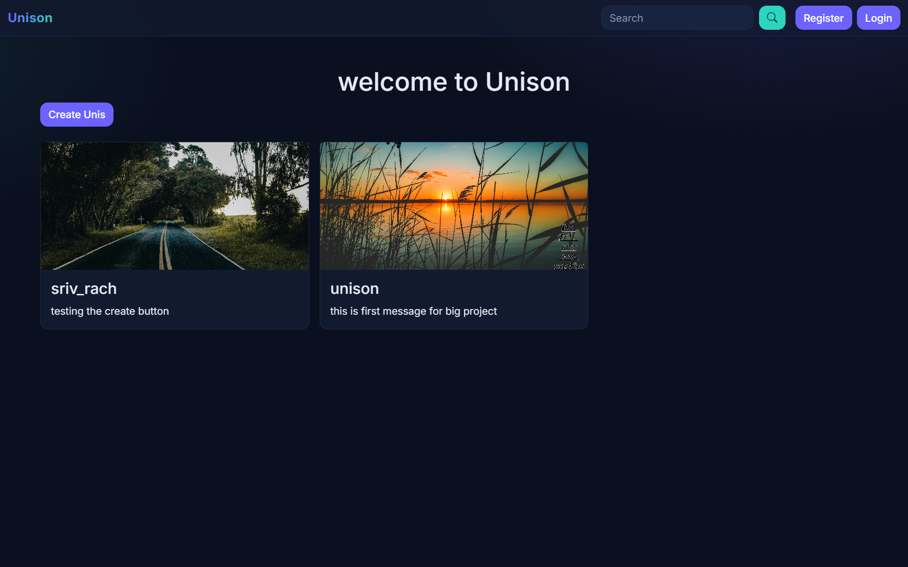

# Unison 
### A lightweight, Twitter-inspired Django web application where users can create profiles, share and discover Posts.

## ✨ Features
- **Authentication:** register, log in and log out.
- **Full CRUD:** create, read, update and delete your own Unis (a Unis is a text post with a photo).
- **Ownership rules:** Edit and Delete buttons only appear on your own posts.
- **Global feed:** the home page shows every Unis shared on the platform.
- **Search facility:** find Unis/posts by keyword from the navbar.
- **Adaptive user interface:** dark theme, mobile-friendly navbar and a card grid that adapts to screen size.


## 📽️ UI Preview
#### Login view:


#### Create view:


#### Logout view:



## Tech Stack
- **Backend:** Python 3.13, Django, SQLite
- **Frontend:** HTML, CSS, Bootstrap 5.3, Bootstrap Icons
- **Forms:** django-crispy-forms with crispy-bootstrap5
- **Images:** Pillow
- **Environment:** uv


## Getting Started

**Prerequisites:** Python 3.13 and [uv](https://docs.astral.sh/uv/) installed.

**1. Clone the repository:**
```bash
git clone https://github.com/AKSHAT0405/Unison.git
cd Unison
```

**2. Set up the virtual environment:**
```bash
uv venv
```
Activate it (Windows):
```bash
.venv\Scripts\activate
```

**3. Install dependencies:**
```bash
uv pip install -r requirements.txt
```

**4. Set up the database:**
```bash
python manage.py migrate
```

**5. Create an admin account (optional but recommended):**
```bash
python manage.py createsuperuser
```

**6. Run the local development server:**
```bash
python manage.py runserver
```

Open `http://127.0.0.1:8000/` in your browser to view the application.

## License
This project is open-source and available under the [MIT License](LICENSE).